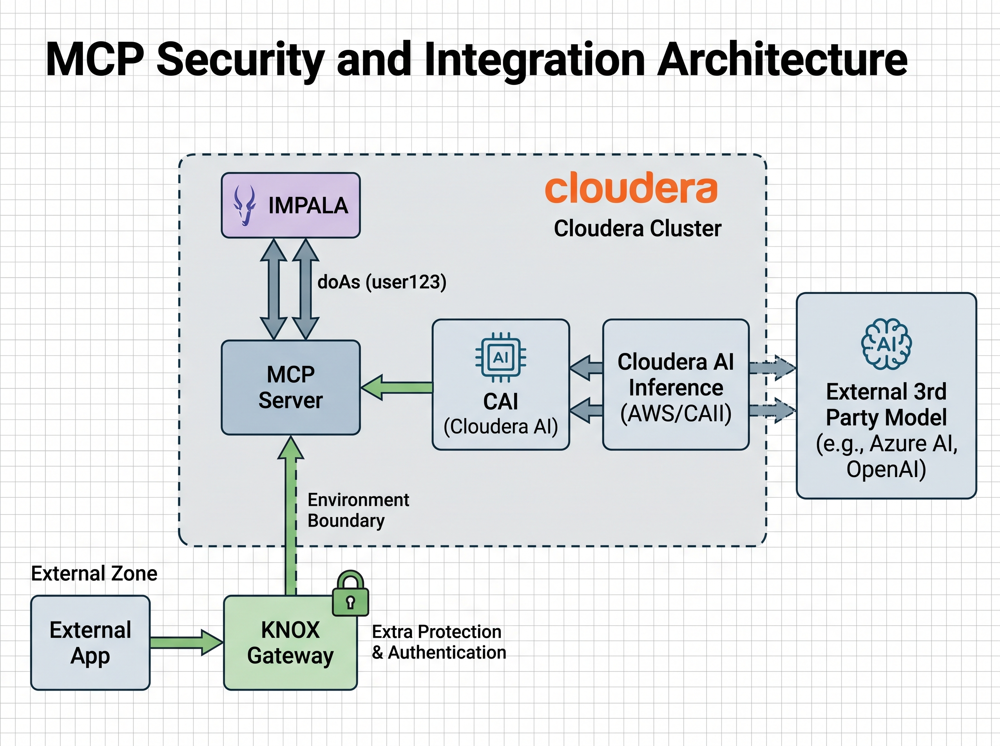

# Cloudera Iceberg MCP Server (via Impala)

A [Model Context Protocol](https://modelcontextprotocol.io) server that lets AI assistants query Iceberg
tables through Apache Impala, **read-only and as the person who asked**. It comes with a chat app that
runs inside Cloudera AI (CAI).

Tools offered to the AI:
- `get_schema()`: the tables in the configured database, with their columns.
- `execute_query(query)`: run one read-only SQL statement and return the rows as JSON.

## Architecture



**The core rule: every query runs in Impala as the individual who asked, never as a shared service
account.** Ranger decides what that person may read, and Impala's query log records their name.

### How a question becomes a query

1. A person asks a question in an AI app.
2. The app calls the MCP server, carrying **proof of who the person is**.
3. The MCP server **verifies that proof** and works out the person's Cloudera username.
4. It connects to Impala as a dedicated **machine user** and asks to run the query **as that person**
   (impersonation, Impala's `doAs`).
5. Impala checks that the machine user is allowed to impersonate that person, then **Ranger** checks
   that the person may read the tables.
6. The **query log records both names**: the person (`db_user`) and the machine user that connected
   for them (`db_user_connection`).

### Two ways in, one identity rule

| | External app (e.g. Azure AI Foundry) | Chat app hosted in Cloudera AI (`chat_app/`) |
|---|---|---|
| Who signs the person in | Their identity provider (Microsoft Entra ID; in principle any standard OIDC provider) | Cloudera AI's own login (e.g. company SSO) |
| Proof sent to the MCP server | A signed token issued for that person | CAI's proxy stamps the authenticated caller on every request (callers cannot forge it); the chat app, the only trusted caller, names the person |
| What the MCP server checks | Signature, issuer, audience, expiry (optionally a required scope) | Caller is CAI-authenticated and listed in `CAI_TRUSTED_CALLERS` |
| Network perimeter | Optional Apache Knox gateway in front, which checks the token before it reaches Cloudera | Not needed: traffic stays inside Cloudera |
| MCP Application login setting | Off (the token is the gate) | On (CAI login is the gate) |

The identity mode is chosen by settings (see [Configuration](#configuration)). A third, **test mode**,
runs every call as one fixed user with no identity check. It exists only to prove a first deployment
and must not be exposed beyond a controlled test.

### Layers of protection

| Layer | Where | What it stops |
|---|---|---|
| 1. Caller identity | MCP server (token check) or CAI login | Anonymous or forged callers |
| 2. Identity mapping and allowlists | MCP server (`USER_MAP`, `ALLOWED_USERS`) | Unknown or unwanted users |
| 3. Read-only guard | MCP server | Writes and stacked statements (defence in depth) |
| 4. Impersonation allowlist | Impala (`authorized_proxy_user_config`) | The machine user acting as anyone not on the list |
| 5. Data permissions | Ranger, per person | Reading data the person is not entitled to |
| 6. Audit trail | Impala query log and Ranger audit | Untraceable access: every query is recorded under the person's name |

Safe defaults throughout:
- **Deny by default.** Missing, invalid or unmapped identities are refused.
- **No silent fallbacks.** The server refuses to start without an identity mode, never falls back to the
  machine user, and refuses to combine Entra with CAI mode.
- **Misconfiguration fails closed.** In CAI mode the server refuses to start if its Application allows
  unauthenticated access. Even then, CAI strips forged identity headers (tested), so calls would be
  refused, not impersonated.
- **Secrets stay out of the repo.** The machine user's password lives only in Application settings, and the
  diagnostic `whoami` tool never returns a token.

The chat app's model is either **Cloudera AI Inference** (inside Cloudera, authenticated with the user's
CAI login token) or **AWS Bedrock** (AWS access keys or a Bedrock API key). Either way, the model only
sees results that the person's own permissions allowed.

### Verified end to end

- An **Azure AI Foundry** agent queried through the MCP server, and Impala's query log showed the real
  end user as `db_user`, with the machine user as `db_user_connection`.
- The **CAI chat app** answered questions for two different users. Each person's queries appear in the
  query log under their own name, and Ranger checked each person's own access.

See `docs/install-guide.md` for the full setup (Impala, Ranger, impersonation, deployment) and
`docs/build-plan.md` for the design history.

## Deploy on Cloudera AI

`.project-metadata.yaml` turns this repo into a Cloudera AI project template. You choose the mode
with `MCP_MODE`:

| `MCP_MODE` | What gets deployed | CAI login |
|---|---|---|
| `cai` (default) | MCP server for apps in this workspace, **plus the chat app** (if a model is configured) | On, for both |
| `entra` | MCP server for an external app that sends Entra ID tokens | Off; the server checks every token |
| `test` | MCP server where every call runs as `MCP_TEST_USER`, with no identity check | Off; anyone with the URL can query |

1. In Cloudera AI: **New Project > Git**, paste this repo's URL, then **Configure Project**.
2. Fill in the environment variables it asks for:

   | Variable | What to enter |
   |---|---|
   | `MCP_MODE` | `cai`, `entra` or `test` |
   | `IMPALA_HOST` | Impala coordinator host |
   | `IMPALA_USER` | The machine user's **workload** username (machine users get an extra `srv_` prefix) |
   | `IMPALA_PASSWORD_B64` | Its password, base64-encoded: `printf %s 'PASSWORD' \| base64 -w0` |
   | `IMPALA_PORT`, `IMPALA_DATABASE` | Defaults are `443` and `default` |
   | cai: `CAI_INFERENCE_BASE_URL` or `BEDROCK_MODEL_ID` | The chat app's model; `CAI_TRUSTED_CALLERS` defaults to you |
   | entra: `ENTRA_TENANT_ID`, `ENTRA_AUDIENCE` | From the server's Entra app registration |
   | test: `MCP_TEST_USER` | The Cloudera user every request runs as |

3. Launch. It installs dependencies, creates an optional sample-data job (not run automatically),
   and runs `scripts/create_mcp_app.py`, which creates the applications for the mode with the right
   CAI login setting. The MCP endpoint is the MCP application's URL plus `/mcp`.
4. Check it: `scripts/curl_mcp.sh https://<application-url> list` (see below).

If the template's variables don't reach the project (a known issue in some CAI versions), set them
in **Project Settings > Advanced > Environment Variables** and run `python scripts/create_mcp_app.py`
from a session. See `docs/install-guide.md` §5d.

Before you start, on the Impala side: the machine user must be allowed to impersonate the end users
(`authorized_proxy_user_config`), and they need Ranger access to the tables (install guide §4). To
try it with demo data, run the **Load MovieLens sample data** job, then set `IMPALA_DATABASE` to
`mcp_demo` in the MCP application's settings and restart it.

Things to know:
- **Unauthenticated applications can be blocked** by a workspace admin ("unauthenticated access to
  applications prevented by site-wide configuration"). Entra and test mode need them allowed.
- In test mode anyone with the URL can run read-only queries as `MCP_TEST_USER`. Stop it when idle.
- The subdomains `iceberg-mcp` and `iceberg-mcp-chat` must be unused in the workspace (change them
  with `APP_SUBDOMAIN`), and the workspace must be able to reach PyPI. The runtime is PBJ Workbench,
  Python 3.12, Standard.
- The template is checked by tests (`tests/test_project_metadata.py`, `tests/test_create_apps.py`),
  but the first import into a fresh workspace is the real test.

## Check the server with curl

```
scripts/curl_mcp.sh https://<application-url> health                       # is it up? (no token needed)
scripts/curl_mcp.sh https://<application-url> list                         # which tools does it offer?
scripts/curl_mcp.sh https://<application-url> call get_schema
scripts/curl_mcp.sh https://<application-url> call execute_query '{"query":"SELECT effective_user()"}'
```

A server that checks tokens needs one: `TOKEN=<token> scripts/curl_mcp.sh ...` (or `TOKEN_FILE=<path>`).
No token gives `HTTP 401`, which is the correct answer from such a server. The script needs only
`curl`. An MCP server expects a short conversation first (initialize, confirm, then your request),
which the script does for you; the three steps are described at the top of the script.

## Configuration

| Variable | Purpose |
|---|---|
| `IMPALA_HOST`, `IMPALA_PORT` (443), `IMPALA_DATABASE` | Impala coordinator |
| `IMPALA_USER` | Machine user that authenticates (and is allowed to impersonate via `authorized_proxy_user_config`) |
| `IMPALA_PASSWORD_B64` (or `IMPALA_PASSWORD`) | Machine user workload password, base64 preferred |
| `ENTRA_TENANT_ID`, `ENTRA_AUDIENCE` | Enable Entra token validation. Audience is the app registration's Application ID URI |
| `ENTRA_ISSUER`, `ENTRA_JWKS_URI` | Optional overrides (default to the v2.0 issuer/keys for the tenant; use `https://sts.windows.net/<tenant>/` for v1 tokens) |
| `ENTRA_USER_CLAIMS` | Claims tried in order for identity (default `preferred_username,upn,email`); the local part becomes the Cloudera username |
| `USER_MAP` | Optional `identity=cloudera_user` pairs (comma-separated) for tokens whose identity is not a Cloudera name. When set it is exclusive: unlisted identities are rejected |
| `ENTRA_REQUIRED_SCOPE` | Optional. If set (e.g. `access_as_user`), tokens without that permission are rejected. Off by default: turn on after `whoami` shows what real callers send |
| `MCP_ENABLE_WHOAMI` | Optional. `1` adds a `whoami` tool that shows non-secret details of the caller's verified token (never the token). For demos and debugging |
| `ALLOWED_USERS` | Optional comma-separated allowlist of Cloudera usernames |
| `CAI_TRUSTED_CALLERS` | CAI mode, for callers hosted in Cloudera AI: comma-separated CAI usernames allowed to act on behalf of other users (send `X-On-Behalf-Of`). Any other CAI user runs as themselves. The Application **must** have CAI authentication on |
| `MCP_TEST_USER` | **Test deployments only:** skip identity checks and run every call as this user. Ignored when `ENTRA_*` or `CAI_TRUSTED_CALLERS` is set |

The server refuses to start unless one identity mode is set: `ENTRA_TENANT_ID`+`ENTRA_AUDIENCE` (external
apps), `CAI_TRUSTED_CALLERS` (CAI-hosted apps) or `MCP_TEST_USER` (test only). Entra and CAI mode together
is refused, because they need opposite Application login settings.

### Chat app (`chat_app/`)

Deploy as a second Application with script `start_chat.py` and CAI authentication **on**. Its dependencies
are the `chat` extra (`pip install ".[chat]"`), which `start_chat.py` installs.

| Variable | Purpose |
|---|---|
| `MCP_URL` | The CAI-mode MCP server endpoint, e.g. `https://iceberg-mcp-cai.<workspace-domain>/mcp` |
| `MCP_API_KEY` | Optional. CAI API key the chat app calls the MCP server with; its owner must be in `CAI_TRUSTED_CALLERS`. Default: the key of the user the Application runs as |
| `CAI_INFERENCE_BASE_URL` | Cloudera AI Inference: the endpoint's OpenAI-compatible URL from its Model Endpoints page. The model name and login token are found automatically |
| `BEDROCK_MODEL_ID`, `AWS_REGION` | AWS Bedrock, plus either `AWS_BEARER_TOKEN_BEDROCK` or `AWS_ACCESS_KEY_ID`/`AWS_SECRET_ACCESS_KEY` |
| `LLM_PROVIDER` | `cai` or `bedrock`; only needed when both are configured |
| `CHAT_TEST_ACT_AS` | **Testing only.** CAI users who get an "Act as" box to query as someone else. Leave unset in production |

## Testing

```
pip install -e ".[chat]" --group dev   # everything comes from pyproject.toml
pytest                                   # unit + end-to-end auth tests, no Cloudera needed
python scripts/test_doas.py --allowed <user> --denied <user>   # against a real Impala VW
python scripts/get_entra_token.py                               # real Entra sign-in (device code) -> .entra_token
python scripts/call_mcp.py <url> get_schema --token-file .entra_token --claims   # against a deployed server
```

## Usage with AI frameworks

The `./examples` folder contains several examples how to integrate this MCP Server with common AI Frameworks like LangChain/LangGraph, OpenAI SDK.

### Transport

The MCP server's transport protocol is configurable via the `MCP_TRANSPORT` environment variable. Supported values:
- `stdio` **(default)** — communicate over standard input/output. Useful for local tools, command-line scripts, and integrations with clients like Claude Desktop.
- `http` - expose an HTTP server. Useful for web-based deployments, microservices, exposing MCP over a network.
- `sse` — use Server-Sent Events (SSE) transport. Useful for existing web-based deployments that rely on SSE.


*Copyright (c) 2025 - Cloudera, Inc. All rights reserved.*
