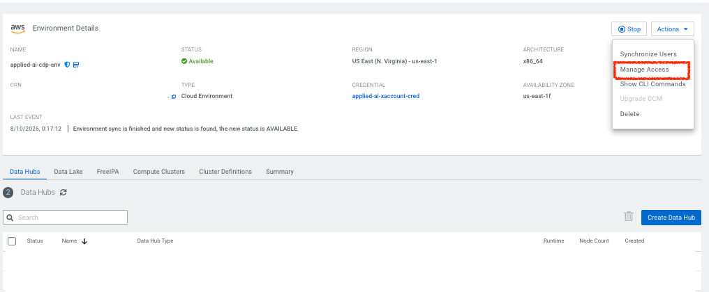
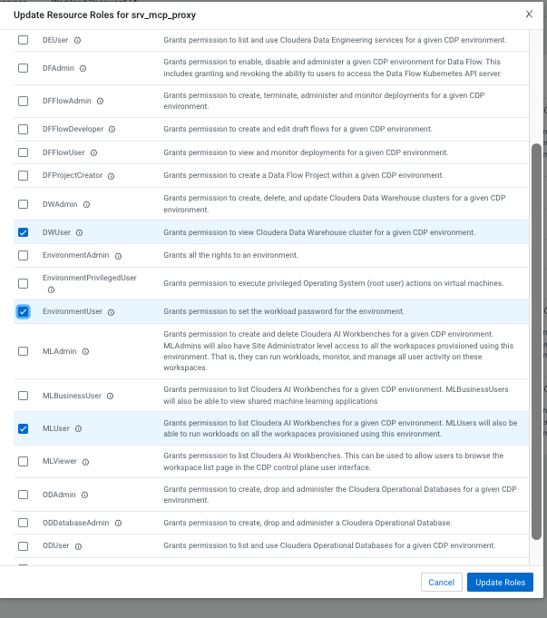
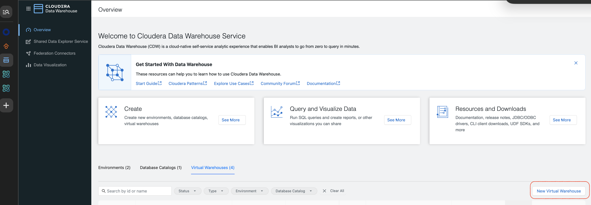
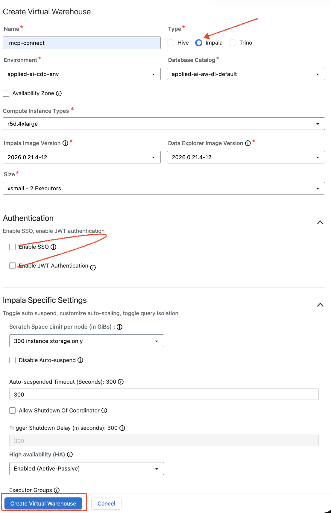
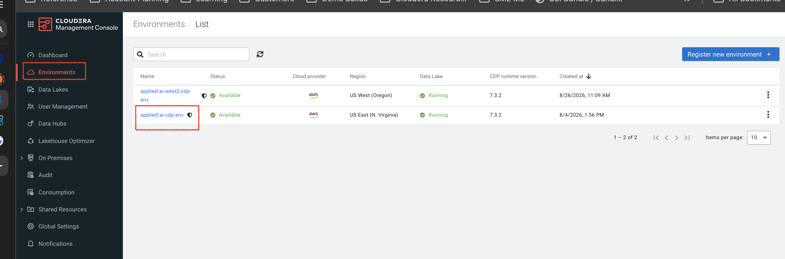
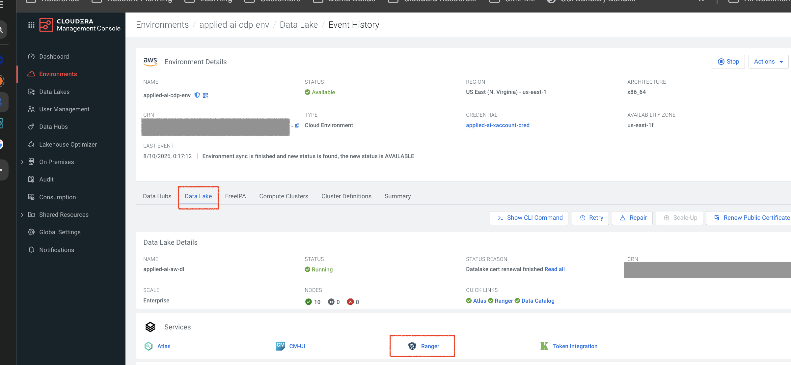
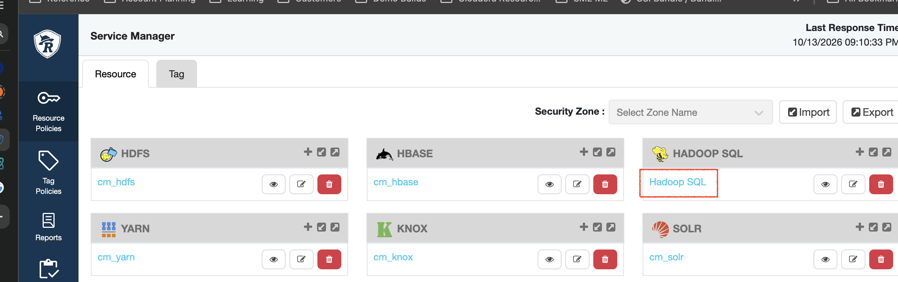

# Install Guide — Iceberg MCP Server on Cloudera (Impala)

This guide installs and configures the **Iceberg MCP Server** on Cloudera AI (CAI, formerly CML),
the **Impala** virtual warehouse it queries and, optionally, the bundled **chat app**. It covers
everything from importing this repository to a verified deployment where every query runs as the
end user.

**Scope.** For external callers (Entra mode), this guide stops at the MCP server's front door: it
expects the caller to present a per-user bearer token, and how that token is produced (the calling
application, any gateway in between) is out of scope. For apps hosted in Cloudera AI (CAI mode), the
whole path is covered, including the chat app.

---

## 1. Overview & architecture

The MCP server exposes two read-only tools to an AI agent:

- `get_schema()`: list the tables in the configured database, with their columns.
- `execute_query(query)`: run one read-only SQL statement and return JSON.

Every call runs **as the end user**, not as a shared service account:

```
Caller (chat app in CAI, or an external agent)
   │  who is the end user?  (depends on the mode, below)
   ▼
MCP server  (Cloudera AI Application)
   │  1. establish the end user's identity
   │  2. map it to a Cloudera username
   │  3. connect to Impala as the machine user, impersonating that username (doAs)
   ▼
Impala Virtual Warehouse (CDW)  →  Ranger authorization + audit show the end user
```

**Choose a mode.** It decides how the server learns who the end user is, and whether the CAI
Application asks people to log in:

| Mode (`MCP_MODE`) | For | Identity comes from | CAI login on the MCP app |
|---|---|---|---|
| **`cai`** (default) | Apps hosted in this CAI workspace, such as the bundled chat app | CAI's login. CAI tells the server who is calling; a trusted app (the chat app) may name the user it acts for | **On** |
| **`entra`** | An external app, e.g. an Azure AI Foundry or Copilot agent | An Entra ID token on every request, checked by the server | Off (an external app can't use CAI's login) |
| **`test`** | Trying it out | Nobody: every call runs as one fixed user, `MCP_TEST_USER` | Off |

There are **two independent authorization gates** on the Impala side, whatever the mode. Keeping
them straight prevents most setup problems:

| Gate | Question it answers | Where you configure it |
|---|---|---|
| **doAs allowlist** | *May the machine user impersonate this user?* | Impala coordinator (`authorized_proxy_user_config`), §4c |
| **Ranger** | *May that user read this table?* | Ranger policies, §4d |

A user must pass **both**. The MCP server adds its own checks on top (the caller's identity, the
identity mapping, an optional allowlist).

---

## 2. Prerequisites

- A **Cloudera AI workspace** you can create a project in, with outbound access to PyPI.
- **CDP admin rights** to create a machine (service) user and sync it to the environment.
- Each **end user** you intend to impersonate must be a synced workload user in that environment
  with **MLUser + DWUser + EnvironmentUser** roles and Ranger access (see §4e).
- An **Impala Virtual Warehouse** in Cloudera Data Warehouse (or the ability to create one).
- Free application **subdomains** in the workspace: `iceberg-mcp` and, in CAI mode, `iceberg-mcp-chat`
  (change them with `APP_SUBDOMAIN`).
- Runtime: **PBJ Workbench, Python 3.12, Standard** (set in `.project-metadata.yaml`).
- **CAI mode, for the chat app:** a model. Either a **Cloudera AI Inference** endpoint that supports
  tool calling (tested with `Qwen/Qwen2.5-7B-Instruct`), or **AWS Bedrock** access.
- **Entra mode:** an **Entra ID app registration** representing this server. You need its
  **Application ID URI** (the token *audience*) and the **tenant ID**. (Registering it is out of
  scope; see `docs/entra-app-registration-checklist.md`.)

---

## 3. Identity & access model (read this first)

**CAI mode.** When CAI login is on for an Application, CAI's proxy authenticates every request
(a browser login, or a CAI API key) and passes the user's name to the app in the `Remote-User`
header, overwriting anything the client sent. The MCP server runs each call as that user. One
exception: a caller listed in **`CAI_TRUSTED_CALLERS`** may add an `X-On-Behalf-Of: <user>` header
and the call then runs as that user instead. That is how the chat app works: it calls the server
with its creator's API key (so `Remote-User` is the creator) and names the logged-in chat user.
Anyone not in the list always runs as themselves.

> **CAI login must stay on for the MCP Application in CAI mode.** The server checks this at
> startup and refuses to start if its Application allows unauthenticated access. (Tested: with login
> off, CAI also strips a client-sent `Remote-User`, so every call would be refused anyway.)

**Entra mode: how a token becomes a Cloudera user.** After the token is validated, the server maps
its identity claim to a Cloudera username:

- **Default:** the local part of the first present claim among `preferred_username`, `upn`, `email`
  — e.g. `jdoe@example.com` → `jdoe`. If your email handle already equals the Cloudera
  username, **no mapping configuration is needed**.
- **`USER_MAP`** (optional): explicit `identity=cloudera_user` pairs for when the handle differs,
  e.g. `USER_MAP=jane.doe@example.com=jdoe`. When set it is **exclusive** — identities not
  listed are rejected.
- **`ENTRA_USER_CLAIMS`** (optional): override which claims are tried, in order.

**The machine user + `doAs` (all modes).** The server authenticates to Impala as one machine user
(LDAP, over HTTPS) and asks Impala to run each statement as the end user via
`http_path=cliservice?doAs=<user>`. Impala's `authorized_proxy_user_config` decides who the machine
user is allowed to impersonate — the second gate behind the server's own checks.

---

## 4. Cloudera-side setup (Impala)

### 4a. Machine (service) user
1. Create the machine user if it does not exist (needs CDP admin).
2. In the target **Environment**, open **Actions → Manage Access**, find the machine user and grant
   it **MLUser** (the Cloudera AI application runs under this account), **EnvironmentUser**, and
   **DWUser**.

   

   

3. **Environment → Actions → Synchronize Users**; wait for completion so FreeIPA has the account.
4. Set the machine user's **workload password** (per-user, in the CDP profile). This is the password
   the server logs in with. **Save it somewhere safe right away:** CDP will not show it again, and
   the only fix later is to reset it and update `IMPALA_PASSWORD_B64` everywhere it is used.

> **Name check.** The machine user's **workload username** is what Impala sees, and for machine
> users CDP adds a `srv_` prefix: a machine user shown as `srv_mcp_proxy` logs in as
> `srv_srv_mcp_proxy`. Use the workload username for `IMPALA_USER` and in §4c.

### 4b. Impala Virtual Warehouse
1. In **Cloudera Data Warehouse → Overview → Virtual Warehouses**, click **New Virtual Warehouse**.

   

2. **Type must be Impala** (the console often defaults to Hive). Pick the environment and its
   database catalog.
3. **Enable SSO and Enable JWT Authentication = both off.** The MCP server validates tokens in code;
   Impala itself authenticates the machine user by LDAP password, not JWT.

   The other settings can stay at their defaults (an `xsmall` size is enough for testing). Note that
   **auto-suspend** is on by default (300 s): a suspended warehouse answers `HTTP 503` until it has
   woken up (see §9).

   
4. Note the **coordinator host** (e.g. `coordinator-<name>.<env>.<region>.cloudera.site`). This is
   `IMPALA_HOST` later — without the `https://` prefix.

### 4c. doAs proxy config  ⚠️ most common failure point
1. In the VW: **Configurations → Impala Coordinator**.
2. Set the top dropdown to **flagfile**.
3. Add a custom configuration:
   - **Key:** `authorized_proxy_user_config`
   - **Value:** `<env-system-account>=*;<machine-user>=user1,user2,user3`

   Example:
   ```
   srv_env-xxxxxx=*;svc_mcp_proxy=user1,user2,user3
   ```

   Two mistakes that cause `User '<machine-user>' is not authorized to delegate to '<user>'`:
   - **Wrong spelling of the machine user.** It must match the account that actually authenticates,
     exactly (short name, no domain). A single extra character fails silently until a call is made.
   - **Overwriting the environment system account entry.** The value is `;`-separated. Read the
     existing value and **append** your `machine-user=...` rule — do not replace the `...=*` entry
     that is already there.
   **Who the machine user may impersonate:**
   - **Explicit list** (`<machine-user>=user1,user2`): tightest, but every new user needs an edit and
     a warehouse restart.
   - **Group** (recommended for production): leave the machine user out of
     `authorized_proxy_user_config` and add a second key,
     `authorized_proxy_group_config` = `<machine-user>=<group>`. Adding someone is then a group
     membership change instead of a config edit (verify with `test_doas.py` after adding someone).
   - **Wildcard** (`<machine-user>=*`): convenient for testing, but the machine user can then
     impersonate anyone, including admins, so only the MCP server's own checks and Ranger remain.
     Not for production.

4. **Save and restart** the warehouse so the coordinator reloads the flag. (A soft refresh may not
   pick up startup flags.)

### 4d. Ranger grants
Each impersonated user needs **select** on the database and tables you will query, in Ranger's
**Hadoop SQL** service (that is the service Impala checks). Without it, `doAs` connects fine but
`SHOW TABLES` returns nothing and `SELECT` is denied.

**Open Ranger.** Management Console → **Environments** → your environment → **Data Lake** tab →
**Ranger** (under Services).





**Open the Hadoop SQL policies.** In Service Manager, click **Hadoop SQL** under HADOOP SQL, then
**Add New Policy** (top right).



**Fill in the policy** (one policy per database is enough):

| Field | Value |
|---|---|
| Policy Name | e.g. `mcp_demo` |
| Policy Label | Leave empty (optional tag for searching policies; no effect on access) |
| Enabled / Normal / Audit Logging | Leave as is. **Audit Logging must stay on**: the per-user audit trail is the point of this setup |
| Policy Conditions (top right) | Leave empty |
| Hive Database → *Add policy Resources* | `mcp_demo` (type it and press **Enter** so it becomes a tag) |
| Hive Table | `*` |
| Hive Column | `*` |
| Include toggles | Leave on **Include**; don't use **Add Resource** |

Under **Allow Conditions**, first row:

| Column | Value |
|---|---|
| Select Roles / Select Groups | Empty, or a group (see below) |
| Select Users | The users the MCP server will impersonate |
| Add Conditions | Leave empty (extra rules such as IP ranges; easy to block access by mistake) |
| Permissions | Click **+**, tick **select** only, click ✓ to apply |
| Delegate Admin | Leave unticked (it would let them edit this policy) |

Leave **Exclude from Allow Conditions** and everything below it empty, then click **Add** at the
bottom.

Notes:
- **select is enough.** It allows reading and makes the tables show up in `SHOW TABLES`. Don't grant
  **all**: in test mode every caller runs as the same user, so extra rights apply to every caller.
- **The user who created the database** (e.g. the one that ran §6) usually has access already and
  does not need to be in the policy.
- **Groups.** If impersonation is scoped to a group (§4c), grant the same group here; adding a person
  is then one group-membership change.
- **Allow a short delay.** Ranger pushes policies to Impala periodically (typically within ~30 s).
  Then verify with `scripts/test_doas.py --allowed <users> --explore` (§7, Layer 1).

### 4e. End users (the doAs targets): environment access
The users you impersonate must be **real, recognized workload identities in the same CDP
environment**, or Impala cannot resolve them for `doAs`. In the **CDP Management Console**, each
end user needs:
1. To exist as a CDP user (created there, or synced from your identity provider).
2. These resource roles on the **Environment** (same **Manage Access** screens as §4a): **MLUser**,
   **DWUser**, and **EnvironmentUser** —
   then run **Environment → Actions → Synchronize Users** so the workload layer (FreeIPA) knows the account.
3. The **Ranger** data grants from §4d (SELECT on the database/tables).
4. To be listed as a target in the machine user's **`authorized_proxy_user_config`** (§4c).

> Verify the setup empirically with `scripts/test_doas.py` (§7, Layer 1): `--allowed` users that are
> configured correctly connect; anything missing fails there, before the MCP server is involved.

---

### 4f. Checklist: giving one more person access
Use this whenever someone new should be able to query through the MCP server or the chat app:

1. **Management Console → Environment → Actions → Manage Access:** give them **MLUser**, **DWUser**
   and **EnvironmentUser** (§4e), then **Actions → Synchronize Users**.
2. **Impersonation (§4c):** nothing to do with a wildcard or a group rule (add them to the group);
   with an explicit list, append them to the machine user's entry and restart the warehouse.
3. **Ranger (§4d):** add them, or their group, to the database's policy with **select**.
4. **MCP server:** if `ALLOWED_USERS` is set, add them there; in Entra mode, also to `USER_MAP` if you
   use it. In CAI mode, check that they can open the chat app's URL with their own login.
5. **Check** before telling them it works: `python scripts/test_doas.py --allowed <user> --explore`
   (§7, Layer 1).

---

## 5. Deploy (this repo)

### 5a. Import the project
In Cloudera AI: **New Project → Git**, paste this repository's URL, then **Configure Project**. The
included `.project-metadata.yaml` turns the repo into a template: it asks for the variables in §5b,
then runs the tasks in §5c.

> **Cloned into an existing project instead?** If the repo is a folder inside a project (e.g.
> `/home/cdsw/iceberg-mcp-server`), everything still works: the scripts find the repo in
> `/home/cdsw` or one folder below it. Application script paths then include the folder, e.g.
> `iceberg-mcp-server/start_mcp.py`; `scripts/create_mcp_app.py` (§5e) sets that for you.

### 5b. Configure environment variables

Set `MCP_MODE` first; it decides which of the other settings matter.

**Connection (always required):**

| Variable | Value |
|---|---|
| `IMPALA_HOST` | Coordinator host from §4b. A pasted `https://` and trailing `/` are removed |
| `IMPALA_PORT` | `443` for Cloudera Data Warehouse |
| `IMPALA_USER` | The machine user's **workload** username from §4a (with the extra `srv_` prefix) |
| `IMPALA_PASSWORD_B64` | Machine user's workload password, base64-encoded: `printf %s 'PASSWORD' \| base64 -w0` |
| `IMPALA_DATABASE` | Database to query (`default`, or `mcp_demo` after §6) |
| `APP_SUBDOMAIN` | Optional. MCP server subdomain (default `iceberg-mcp`); the chat app gets `<subdomain>-chat` |

**Per mode** (leave the other modes' settings empty: the deploy script refuses them, because the
server would otherwise start in the wrong mode):

| Mode | Set | Notes |
|---|---|---|
| `cai` | `CAI_TRUSTED_CALLERS` (optional), and a model for the chat app: `CAI_INFERENCE_BASE_URL` **or** `BEDROCK_MODEL_ID` | `CAI_TRUSTED_CALLERS` defaults to you, the deployer, because the chat app calls the server with your API key. Without a model, only the MCP server is created |
| `entra` | `ENTRA_TENANT_ID`, `ENTRA_AUDIENCE` (the app's Application ID URI). For v1 tokens also `ENTRA_ISSUER=https://sts.windows.net/<tenant>/` | Validates each caller's token and runs as the mapped user |
| `test` | `MCP_TEST_USER` | Every call runs as this one user, with no identity check. For validation only (§8) |

**Chat app model** (CAI mode):

| Variable | Purpose |
|---|---|
| `CAI_INFERENCE_BASE_URL` | Cloudera AI Inference: the endpoint's OpenAI-compatible URL from its **Model Endpoints** page, ending in `/openai/v1`. No key needed: the app uses the CDP token CAI provides (`/tmp/jwt`), and the model name is read from the endpoint |
| `BEDROCK_MODEL_ID` | AWS Bedrock model or inference-profile id. Also set `AWS_REGION`, and either `AWS_BEARER_TOKEN_BEDROCK` (a Bedrock API key) or `AWS_ACCESS_KEY_ID` + `AWS_SECRET_ACCESS_KEY` |
| `LLM_PROVIDER` | `cai` or `bedrock`; only needed when both are configured |
| `CAI_INFERENCE_MODEL` | Optional; overrides the model name read from the endpoint |

**Optional hardening / mapping:**

| Variable | Purpose |
|---|---|
| `ALLOWED_USERS` | Comma-separated Cloudera usernames; anyone else is rejected (any mode except test) |
| `USER_MAP` | Entra: explicit `identity=cloudera_user` pairs (see §3) |
| `ENTRA_USER_CLAIMS` | Entra: claims tried for identity (default `preferred_username,upn,email`) |
| `ENTRA_REQUIRED_SCOPE` | Entra: require this scope on the token (e.g. `access_as_user`) |
| `MCP_ENABLE_WHOAMI` | `1` exposes a `whoami` diagnostic tool that shows who the server thinks is calling (never a token) |

### 5c. What the template does
The template runs three tasks, in order. If one fails, you can do its job by hand:

| Task | What it does | By hand |
|---|---|---|
| **Install dependencies** | `pip install` this project into the session's Python | `python scripts/install_deps.py` in a session |
| **Load MovieLens sample data (optional)** | Creates a job; does **not** run it (it writes to your warehouse) | See §6 |
| **Create applications for MCP_MODE** | Runs `scripts/create_mcp_app.py`, which creates the MCP server application with the right CAI login setting for the mode, and in CAI mode also the chat app | See §5e |

The applications are created through the API rather than by a `start_application` task because
the CAI login setting depends on the mode, and a template task can only fix one value.

Each application gets **its own copy** of the settings it needs, so it doesn't rely on project-level
variables reaching it. To change a setting later (e.g. `IMPALA_DATABASE`), change it in the
**Application's** settings and restart it; changing the project setting alone has no effect on an
existing application.

### 5d. Known issue: template variables not picked up
Some CAI versions don't store the values entered during **Configure Project** as project
environment variables, so the tasks run without them.

**How to recognize it:**
- The **Create applications** task fails with `Missing settings for cai mode: IMPALA_HOST, ...`
  (or `choose --mode ... or set MCP_MODE`).
- Or, for an application started without them, its log ends with
  `Refusing to start: set ENTRA_TENANT_ID and ENTRA_AUDIENCE ..., CAI_TRUSTED_CALLERS ... or MCP_TEST_USER`.
  That message means the server saw **no** mode settings at all, which is this issue rather than a
  typo in one value.

**Workaround:**
1. **Project Settings → Advanced → Environment Variables:** add the variables from §5b.
2. Open a session and check they are visible (this hides the password):
   ```
   env | grep -E '^(MCP|IMPALA|CAI|ENTRA|BEDROCK|AWS_REGION|APP)_' | sed -E 's/(PASSWORD_B64|TOKEN|SECRET|KEY)[^=]*=.*/\1=<set>/'
   ```
3. Test the Impala side first: `python scripts/test_doas.py --allowed <user> --denied <someone-else>`
   (in a session, see the `HADOOP_USER_NAME` note in §9).
4. Create the applications: `python scripts/create_mcp_app.py` (§5e).

### 5e. Create the applications from a session
`scripts/create_mcp_app.py` does the template's last task, and is safe to re-run: an application
whose subdomain already exists in the project is left alone. Run it from a session in the project:

```
python scripts/create_mcp_app.py                       # uses MCP_MODE and the project settings
python scripts/create_mcp_app.py --mode cai            # MCP server + chat app
python scripts/create_mcp_app.py --mode test --test-user jdoe --details-file /home/cdsw/impala_details.txt
```

- `--details-file` reads the `IMPALA_*` settings from a file instead of the environment (format as
  for `test_doas.py`; `KEY=value` or `key: value`, values already in the environment win). Keep that
  file out of git.
- `--subdomain` overrides `APP_SUBDOMAIN`.
- It picks the newest *PBJ Workbench, Python 3.12, Standard* runtime and the right script path for
  a subfolder checkout, and prints each application's URL and its CAI login setting. It prints no
  secrets.
- To add the chat app later: set the model variables, then run `python scripts/create_mcp_app.py --mode cai`
  again. The existing MCP server is left alone and only the chat app is created.

**Creating an application by hand** (Applications → New Application) works too. Use script
`start_mcp.py` (or `start_chat.py`), the runtime above, 1 CPU / 2 GB, and:
- MCP server, CAI mode: leave **Allow Unauthenticated Access** off.
- MCP server, Entra or test mode: turn **Allow Unauthenticated Access** on (a workspace admin may
  have to allow that, see §9).
- Chat app: leave it off, and set `MCP_URL=https://<mcp-subdomain>.<workspace-domain>/mcp`.

### 5f. Launch and use
The MCP endpoint is the **MCP application's URL + `/mcp`**. On start, `start_mcp.py` installs the
package and serves MCP over HTTP; the first start takes a minute or two.

**Chat app (CAI mode).** Open the **Iceberg data chat** application. It shows who you are signed in
as and which model it uses; every query runs as you, so you see only what Ranger allows you to see.
Each tool call (the SQL and its result) can be expanded under the answer. Two settings are for
testing only:
- `CHAT_TEST_ACT_AS`: CAI users listed here get an **Act as** box to query as someone else. The
  audit log then shows the chosen user, not who was typing. **Remove it before real users get
  access.**
- `MAX_TOOL_CALLS` (default 8): tool calls allowed per question.

---

## 6. (Optional) Load sample data to validate

To prove the pipeline with throwaway data, run the **Load MovieLens sample data** job (Jobs page).
It creates database `mcp_demo` (4 Iceberg tables, ~124k rows) via `scripts/setup_sample_data.py`:

```
python scripts/setup_sample_data.py --user <cloudera-user>   # --user needs CREATE in Ranger
```

The job writes **as the impersonated user**: `--user`, or by default `MCP_TEST_USER`, or else the
person running it. That user needs CREATE on the database, and the machine user must be allowed to
impersonate them (§4c). Afterward, set `IMPALA_DATABASE=mcp_demo` in the **MCP application's**
settings (§5c) and restart it.

---

## 7. Verification & smoke tests (bottom-up)

Test from the lowest layer up, so a failure points at the right place.

**Layer 1 — Impala `doAs` (no MCP server involved).** With connection details in the environment or
`impala_details.txt`:
```
python scripts/test_doas.py --allowed user1,user2,user3 --denied someone_not_allowed --explore
```
Confirms: a plain connection works; each allowed user's `SELECT effective_user()` returns that user;
a denied user is rejected; and (with `--explore`) what each user can actually read.

**Check the audit trail.** Impala's query log is itself queryable. Rows where `db_user` is the end user
and `db_user_connection` is the machine user are the impersonated queries:
```sql
SELECT db_user, db_user_connection, start_time_utc, sql
FROM sys.impala_query_log
WHERE db_user IN ('user1', 'user2') AND db_user_connection = '<machine-user>'
ORDER BY start_time_utc DESC LIMIT 20;
```
- **Filter on `db_user_connection`.** Without it, the users' own direct queries (where
  `db_user_connection` is the user) are mixed in with the impersonated ones.
- **The log is written with a delay.** Queries can take a few minutes to appear; an empty result
  right after a test is not yet a failure.

**Layer 2 — MCP server reachability (no token).**
```
scripts/curl_mcp.sh https://<application-url> health      # expect: HTTP 200
scripts/curl_mcp.sh https://<application-url> list        # token server: HTTP 401 (correct)
```
A `401` from `list` on a production server is the **right** answer — it means the token gate is live.

**Layer 2b — CAI mode (MCP server and chat app).** Your CAI API key works as the bearer token,
because CAI's proxy turns it into your identity:
```
TOKEN=$CDSW_APIV2_KEY scripts/curl_mcp.sh https://<mcp-application-url> call execute_query '{"query":"SELECT effective_user()"}'
```
Expect your own username. Without the token, expect a redirect to the login page or `401`: CAI login
is on. Then open the chat app, ask a question, and check the audit log above: `db_user` should be
the person logged in to the chat app.

**Layer 3 — Entra mode, full path with a real token.**
```
python scripts/get_entra_token.py --tenant <tenant> --server-id <app-id> --client-id <client-app-id>
python scripts/call_mcp.py https://<application-url>/mcp whoami        --token-file .entra_token --claims
python scripts/call_mcp.py https://<application-url>/mcp get_schema    --token-file .entra_token
python scripts/call_mcp.py https://<application-url>/mcp execute_query --query "SELECT COUNT(*) FROM mcp_demo.movies" --token-file .entra_token
```
`whoami` confirms the identity mapping (`mapped_cloudera_user`); `get_schema` and `execute_query`
confirm the full chain through `doAs` to the data.

---

## 8. Security considerations

- **Each mode has one gate in front of the server; keep it on.**
  - CAI mode: **CAI login on the MCP application.** The server refuses to start without it.
  - Entra mode: **the token check.** The application must allow unauthenticated access (external
    callers can't use CAI's login), so `ENTRA_*` is the only thing keeping strangers out.
  - Test mode: **none.** Anyone with the URL runs as `MCP_TEST_USER`. Keep it to a controlled test.
- **Trusted callers can act as anyone the machine user may impersonate.** Keep
  `CAI_TRUSTED_CALLERS` to the account the chat app runs as. Better still for production: create the
  chat app with a dedicated account and list only that one.
- **The chat app needs CAI login on**, and must not have `CHAT_TEST_ACT_AS` set outside testing.
- **Deny by default.** Unmapped identities, invalid/expired tokens, missing scope, users not in
  `ALLOWED_USERS` and callers without a CAI identity are all rejected.
- **Read-only.** The server rejects writes and stacked statements; `doAs` + Ranger enforce the rest.
- **Secrets.** Store the machine-user password as `IMPALA_PASSWORD_B64`. Project and application
  environment variables are readable by anyone who can edit the project. Never commit credentials;
  keep connection files (`impala_details.txt`, token files) gitignored.
- **Stop idle test apps.**

---

## 9. Troubleshooting

| Symptom | Likely cause / fix |
|---|---|
| Application log: `Refusing to start: set ENTRA_TENANT_ID and ENTRA_AUDIENCE ..., CAI_TRUSTED_CALLERS ... or MCP_TEST_USER` | The application has no mode settings: usually the template-variable issue (§5d) |
| Application log: `Refusing to start: CAI mode needs CAI authentication ON` | The CAI-mode MCP application allows unauthenticated access. Turn that off in its settings and restart |
| Application log: `Refusing to start: ENTRA_* ... and CAI_TRUSTED_CALLERS ...` | Settings for two modes reached the server, often one from the project settings. Clear the one you don't use |
| `Missing settings for <mode> mode: ...` / `... belong to another mode` from `create_mcp_app.py` | Set the named variables, or clear the other mode's (§5b) |
| "Unauthenticated access to applications prevented by site-wide configuration" | Entra and test mode need it; a workspace admin must allow unauthenticated applications |
| Chat app: "Model is not configured" | Set `CAI_INFERENCE_BASE_URL` or `BEDROCK_MODEL_ID` on the chat application (and `LLM_PROVIDER` if both) |
| Chat app: a query is refused for one user only | Expected when Ranger doesn't grant them the table; otherwise check §4f for that user |
| Chat app stays on "Working…" for a minute or more | The warehouse is waking up from auto-suspend (§4b). It answers once it is running |
| `HTTP 503` from the coordinator | Virtual Warehouse is stopped, auto-suspended or restarting. Wait for Running and retry. |
| `User '<machine-user>' is not authorized to delegate to '<user>'` | `authorized_proxy_user_config` missing, misspelled machine user, user not listed, or the env system-account entry was overwritten (§4c). Restart after fixing. |
| `doAs` fails for a user that *is* listed in the proxy config | The impersonated user isn't a fully set-up workload identity — grant MLUser + DWUser + EnvironmentUser and re-run **Synchronize Users** in the Management Console (§4e). Confirm with `test_doas.py`. |
| `SHOW TABLES` empty but `SELECT` works | Ranger: the user lacks the show/SELECT grant on that database (§4d). (Right after creation, allow a moment for catalog propagation.) |
| `HTTP 401` from an Entra-mode MCP server | Missing/expired/invalid token, or token audience/issuer doesn't match `ENTRA_AUDIENCE`/`ENTRA_ISSUER` (watch v1 `sts.windows.net` vs v2 issuer). |
| Entra: mapped to the wrong / no Cloudera user | Email handle ≠ Cloudera username → set `USER_MAP`; or the expected claim isn't present → set `ENTRA_USER_CLAIMS`. Use `whoami` to see what the token carries. |
| A custom client script tries to delegate unexpectedly | Some environments set `HADOOP_USER_NAME`, which the Impala client turns into a `doAs`. Launch such scripts with `env -u HADOOP_USER_NAME …`. (Does not affect the MCP server, which sets `doAs` explicitly.) |

---

## 10. Appendix

**Endpoint.** `https://<application-url>/mcp`

**doAs config template.**
```
<env-system-account>=*;<machine-user>=user1,user2,user3
```

**Base64 a password.**
```
printf %s 'YOUR_PASSWORD' | base64 -w0
```

**Token/identity boundary contract.** The server expects `Authorization: Bearer <JWT>` where the JWT
is signed by the tenant in `ENTRA_TENANT_ID`, has audience `ENTRA_AUDIENCE`, is unexpired, and
carries an identity claim (`preferred_username` / `upn` / `email`) whose handle (or `USER_MAP` entry)
is a valid Cloudera username.

**Related docs.** `README.md` (quick start), `docs/build-plan.md` (architecture & runbook),
`docs/entra-app-registration-checklist.md` (Entra app registration, out of scope here).
